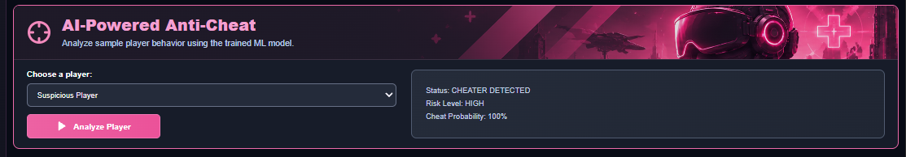
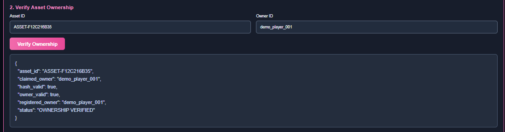
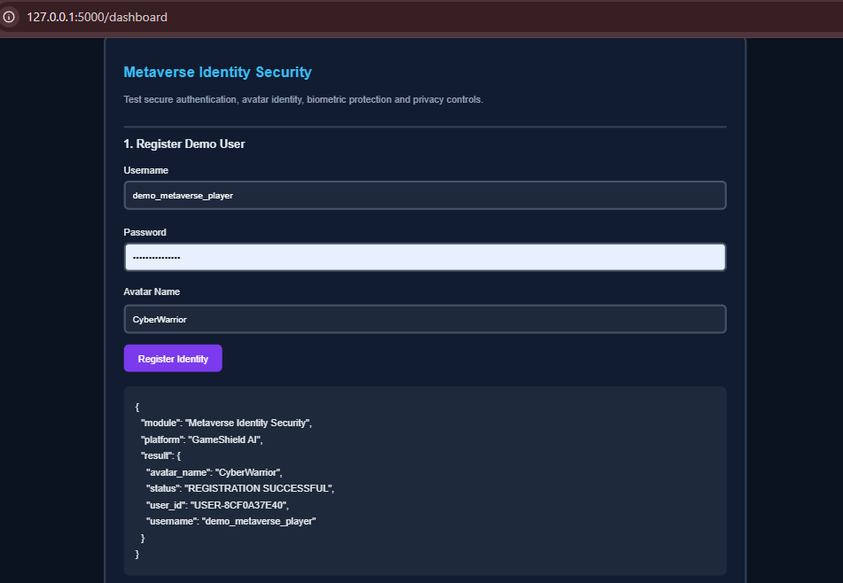
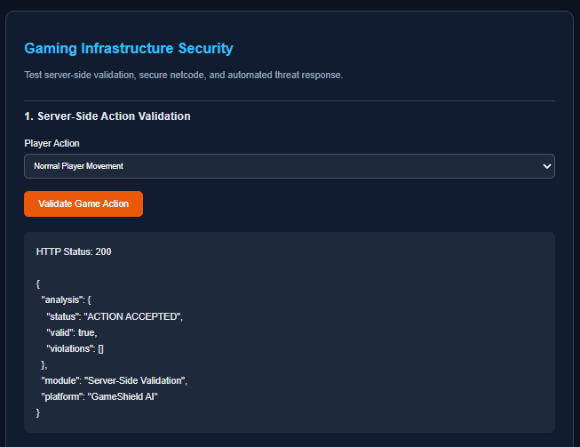
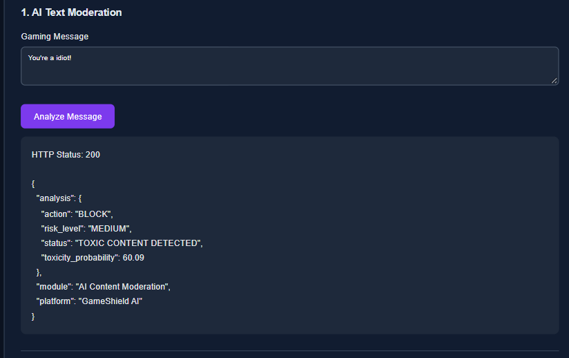
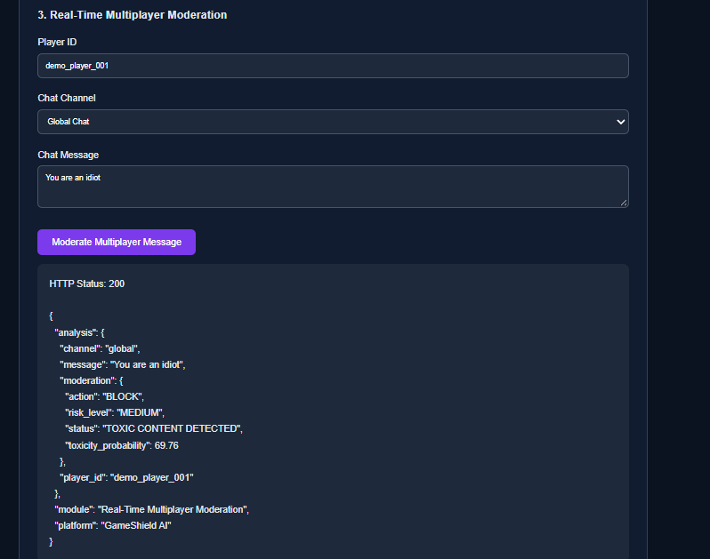
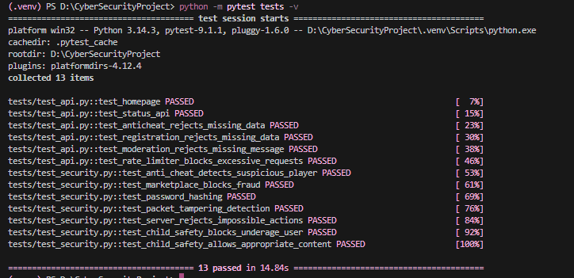
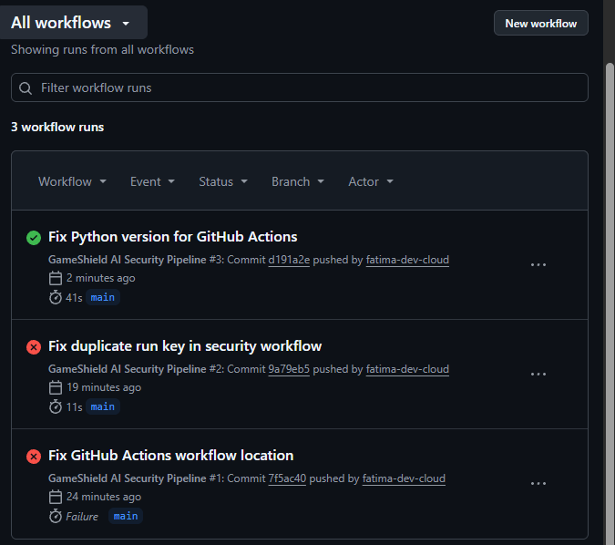
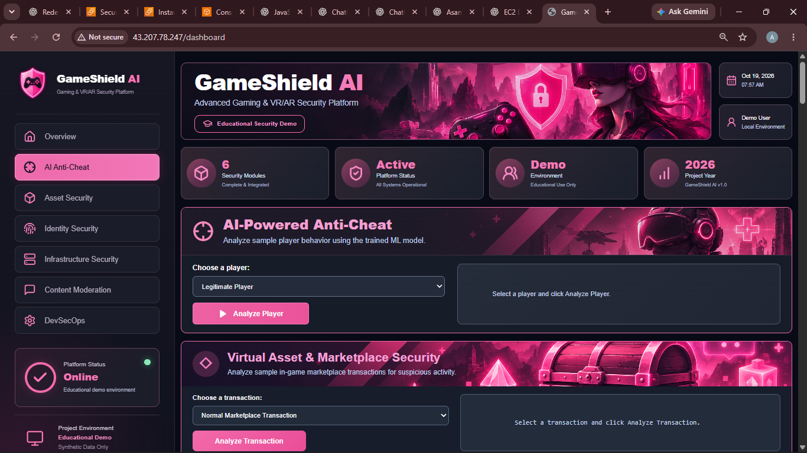

# GameShield AI
## Advanced Gaming and VR/AR Security Platform

**AI-Powered Anti-Cheat, Virtual Asset Protection, Metaverse Identity Security, Gaming Infrastructure Protection, Content Moderation and DevSecOps**

An educational cybersecurity prototype developed for an EduQual Level 6 oral presentation.

---

## 1. Project Overview

GameShield AI is a modular cybersecurity demonstration platform designed to explore security challenges in online gaming, virtual reality (VR), augmented reality (AR), and metaverse environments.

The project combines six security domains in a Python Flask application with a web dashboard and REST APIs.

**Main security modules:**

1. AI-Powered Anti-Cheat
2. Virtual Asset and Marketplace Security
3. Metaverse Identity and Biometric Protection
4. Gaming Infrastructure Security
5. AI Content Moderation and Child Safety
6. DevSecOps and Automated Security Testing

The application was developed on Windows and deployed to an AWS EC2 Ubuntu server using Nginx and Gunicorn.

> **Project scope:** GameShield AI is an educational demonstration. It is not a production-ready gaming security platform.

## 2. Project Objectives

The objectives of this project are to:

- Demonstrate machine-learning-based detection of suspicious player behavior.
- Explore virtual asset ownership verification and marketplace fraud detection.
- Demonstrate secure user authentication and simulated biometric data protection.
- Implement basic application-layer rate limiting, packet verification and server-side game action validation.
- Demonstrate automated text moderation and age-appropriate content filtering.
- Integrate automated testing and security checks into a GitHub Actions workflow.
- Deploy and demonstrate a working cloud-hosted web application.

## 3. Technologies Used

| Technology | Purpose |
|---|---|
| Python | Main programming language |
| Flask | Backend application and REST APIs |
| HTML, CSS, JavaScript | Web dashboard |
| Scikit-learn | Machine learning |
| Pandas and NumPy | Dataset processing |
| Joblib | Model serialization |
| Cryptography | Security-related cryptographic operations |
| Pytest | Automated tests |
| Bandit | Python static security analysis |
| pip-audit | Dependency vulnerability checks |
| Git and GitHub | Version control |
| GitHub Actions | Continuous integration security checks |
| AWS EC2 | Cloud hosting |
| Ubuntu 24.04 LTS | Server operating system |
| Gunicorn | Python application server |
| Nginx | Reverse proxy |
| systemd | Application service management |

## 4. Development Environment

The project was developed using:

- Windows
- Visual Studio Code
- PowerShell
- Python virtual environment (`.venv`)
- Git and GitHub

**Project directory used during development:**

```text
D:\CyberSecurityProject
```

The development computer did not require an Ubuntu virtual machine. Linux deployment was performed separately using AWS EC2.

## 5. Project Structure

```text
CyberSecurityProject/
├── .github/
│   └── workflows/
│       └── security.yml
├── config/
├── data/
│   ├── player_behavior.csv
│   └── moderation_dataset.csv
├── docs/
│   ├── architecture/
│   └── diagrams/
├── logs/
├── models/
├── screenshots/
├── src/
│   ├── anti_cheat/
│   ├── asset_security/
│   ├── content_moderation/
│   ├── devsecops/
│   ├── identity_security/
│   ├── infrastructure_security/
│   ├── static/
│   ├── templates/
│   └── app.py
├── tests/
│   ├── test_api.py
│   └── test_security.py
├── .gitignore
├── README.md
├── requirements.txt
└── requirements-dev.txt
```

Generated model files, local identity records, secrets and private keys are excluded from version control.

## 6. Step-by-Step Windows Installation

### Step 1 — Clone the repository

Open PowerShell and run:

```powershell
cd D:\
git clone https://github.com/fatima-dev-cloud/GameShield-AI.git CyberSecurityProject
cd D:\CyberSecurityProject
```

If the project directory already exists, open the existing directory rather than cloning over it.

### Step 2 — Create a Python virtual environment

```powershell
python -m venv .venv
```

### Step 3 — Activate the virtual environment

```powershell
.\.venv\Scripts\Activate.ps1
```

The PowerShell prompt should display `(.venv)`.

### Step 4 — Install project dependencies

```powershell
python -m pip install --upgrade pip
python -m pip install -r requirements-dev.txt
```

`requirements-dev.txt` includes the application dependencies along with Pytest, Bandit and pip-audit.

**Compatibility note:** The project uses pinned dependency versions. Installation depends on the Python version and availability of compatible packages. The original Windows development and Ubuntu deployment used different Python versions.

## 7. Dataset Preparation

Two demonstration datasets are included in the repository.

### Anti-Cheat Dataset

File:

```text
data/player_behavior.csv
```

This dataset contains sample gameplay behavior, including:

- Accuracy
- Headshot rate
- Reaction time
- Kills per minute
- Impossible actions
- Tracking score
- Cheater classification label

The dataset is synthetic and is intended for demonstration.

### Content Moderation Dataset

File:

```text
data/moderation_dataset.csv
```

This dataset contains sample messages and toxicity labels used to train a basic NLP classifier.

Both datasets are educational samples rather than production datasets.

## 8. AI Anti-Cheat Model Training

### Step 1 — Run the training script

From the project root:

```powershell
python src\anti_cheat\train_model.py
```

### Step 2 — Load and prepare data

The script reads `data/player_behavior.csv` and uses the following features:

```python
FEATURES = [
    "accuracy",
    "headshot_rate",
    "reaction_time",
    "kills_per_minute",
    "impossible_actions",
    "tracking_score",
]
```

### Step 3 — Train the model

The project uses `RandomForestClassifier` with 100 estimators.

The dataset is divided into training and testing portions using a 70/30 split.

### Step 4 — Evaluate the model

The script generates:

- Classification accuracy
- Classification report
- Legitimate and cheater class predictions

### Step 5 — Save the trained model

The generated model is saved to:

```text
models/anti_cheat_model.joblib
```

### Step 6 — Demonstrate suspicious behavior detection

The dashboard allows sample gameplay characteristics to be analyzed.

The anti-cheat module returns a prediction and associated risk information.



> High accuracy on a small synthetic dataset must not be interpreted as real-world anti-cheat performance.

## 9. Virtual Asset and Marketplace Security

The virtual asset security module demonstrates:

- Virtual asset registration
- Ownership verification
- SHA-256-based record integrity
- Duplicate asset detection
- Suspicious marketplace transaction analysis
- Risk-based transaction decisions

### Implementation files

```text
src/asset_security/asset_registry.py
src/asset_security/duplication_detector.py
src/asset_security/fraud_detector.py
```

### Demonstration workflow

1. Register a sample virtual asset.
2. Associate the asset with an owner identifier.
3. Verify the ownership claim.
4. Scan registered assets for duplicates.
5. Submit sample marketplace transactions.
6. Compare legitimate and suspicious transaction results.



**Limitation:** The implementation uses local records and hash-based verification. It does not deploy smart contracts to Ethereum, Polygon or another public blockchain.

## 10. Metaverse Identity Security

The identity security module demonstrates:

- User registration
- Password hashing using PBKDF2-SHA256
- User authentication
- Simulated biometric data protection
- Privacy controls for VR/AR-related data
- Identity-related security logging

### Implementation files

```text
src/identity_security/authentication.py
src/identity_security/biometric_protection.py
src/identity_security/privacy_controls.py
```

### Demonstration workflow

1. Register a demonstration user.
2. Authenticate using the registered credentials.
3. Demonstrate protection of sample motion-tracking or eye-tracking data.
4. Configure privacy preferences.
5. Check whether a sample data-access request is permitted.



**Limitation:** The project does not integrate real VR headsets, eye-tracking hardware or a production identity provider.

## 11. Gaming Infrastructure Security

The infrastructure module demonstrates:

- Application-layer rate limiting
- HTTP 429 responses when request limits are exceeded
- HMAC-based packet integrity checks
- Server-side gameplay action validation
- Rule-based automated threat responses

### Implementation files

```text
src/infrastructure_security/rate_limiter.py
src/infrastructure_security/secure_netcode.py
src/infrastructure_security/server_validation.py
src/infrastructure_security/threat_response.py
```

### Example: Rate limiting

Flask uses a `before_request` hook to evaluate incoming requests.

Requests that exceed the configured limit can receive an HTTP 429 response.

### Example: Server-side validation

The server evaluates sample gameplay actions against predefined rules.

Invalid movement or gameplay values may be rejected.



**Limitation:** Application-level rate limiting is not equivalent to comprehensive network-layer DDoS protection.

## 12. AI Content Moderation and Child Safety

The moderation module uses machine learning and rule-based checks to demonstrate safer gaming interactions.

### Implementation files

```text
src/content_moderation/moderator.py
src/content_moderation/child_safety.py
src/content_moderation/realtime_moderation.py
src/content_moderation/train_moderation_model.py
```

### Step 1 — Train the moderation model

```powershell
python src\content_moderation\train_moderation_model.py
```

### Step 2 — Process the dataset

The script loads:

```text
data/moderation_dataset.csv
```

### Step 3 — Train the NLP classifier

The training pipeline uses:

- TF-IDF text vectorization
- Logistic Regression classification
- A 70/30 train/test split

### Step 4 — Save the model

```text
models/content_moderation_model.joblib
```

### Step 5 — Demonstrate moderation

Submit safe and toxic sample messages through the dashboard.

The application returns moderation decisions and risk information.





### Child Safety

The module also demonstrates age-appropriate content filtering using simplified demonstration categories.

**Limitations:** Voice-chat moderation processes supplied text transcripts rather than live microphone audio. The project does not claim legal COPPA compliance or official ESRB classification.

## 13. Dashboard Development

The web dashboard integrates the security modules into a single interface.

### Main files

```text
src/templates/dashboard.html
src/static/dashboard.css
src/static/dashboard.js
src/app.py
```

The dashboard provides interactive forms, sample security demonstrations and result displays.

### Run the application locally

First train both machine-learning models, then start Flask from the project root:

```powershell
python src\app.py
```

Open:

```text
http://127.0.0.1:5000/dashboard
```

The dashboard communicates with Flask REST APIs.

## 14. Automated Testing

The project includes automated tests in:

```text
tests/test_api.py
tests/test_security.py
```

### Run all tests

```powershell
python -m pytest -q
```

### Run detailed tests

```powershell
python -m pytest tests -v
```

### Verified local result

A verified Windows test run returned:

```text
13 passed in 2.80s
```



These tests demonstrate coverage of selected application functionality. Passing tests do not prove the absence of all security vulnerabilities.

## 15. Security Scanning

### Bandit — Python static analysis

```powershell
python -m bandit -r src -ll
```

### Dependency vulnerability auditing

```powershell
python -m pip_audit
```

### Dependency consistency check

```powershell
python -m pip check
```

The project uses these tools to help identify security and dependency problems.

Security scan results are time-dependent and should be rerun when dependencies or source code change.

## 16. GitHub and DevSecOps CI

### Initialize version control

The project uses Git to track source code, documentation and selected evidence screenshots.

Typical commands:

```powershell
git status
git add README.md
git commit -m "Update project documentation"
git push origin main
```

### GitHub Actions configuration

Workflow file:

```text
.github/workflows/security.yml
```

The workflow is configured to:

1. Check out the repository.
2. Set up Python 3.13.
3. Install development dependencies.
4. Train demonstration machine-learning models.
5. Run automated tests.
6. Run Bandit static security analysis.
7. Run pip-audit dependency scanning.

The workflow runs on pushes and pull requests targeting `main`, and it supports manual execution.



**Deployment clarification:** GitHub Actions runs CI security checks. The current workflow does not automatically deploy the application to AWS EC2.

## 17. AWS EC2 Deployment

GameShield AI was deployed on an AWS EC2 instance running Ubuntu 24.04 LTS.

### Deployment architecture

```text
User Browser
    |
    | HTTP Port 80
    v
AWS Security Group
    |
    v
Nginx Reverse Proxy
    |
    v
Gunicorn (127.0.0.1:8000)
    |
    v
Flask Application
    |
    v
GameShield AI Security Modules
```

### Step 1 — Provision the EC2 instance

An Ubuntu EC2 instance was configured with:

- Ubuntu 24.04 LTS
- SSH access
- HTTP port 80 access restricted by the security group
- Expanded EBS storage
- Swap space to support the limited-memory instance

### Step 2 — Connect through SSH

The Windows development machine used PuTTY to connect to the Ubuntu server.

### Step 3 — Obtain the project

On the Ubuntu server:

```bash
git clone https://github.com/fatima-dev-cloud/GameShield-AI.git
cd GameShield-AI
```

For an existing deployment, update the repository with the appropriate reviewed commit.

### Step 4 — Create the Linux virtual environment

```bash
python3 -m venv .venv
source .venv/bin/activate
```

### Step 5 — Install dependencies

```bash
python -m pip install -r requirements.txt
python -m pip check
```

### Step 6 — Train the demonstration models

```bash
python src/anti_cheat/train_model.py
python src/content_moderation/train_moderation_model.py
```

### Step 7 — Configure Gunicorn

The deployed Gunicorn service runs the Flask application from the `src` directory and listens on:

```text
127.0.0.1:8000
```

The deployment uses one Gunicorn worker.

### Step 8 — Configure systemd

The application is managed by a systemd service named:

```text
gameshield-ai.service
```

Useful administrative commands:

```bash
sudo systemctl status gameshield-ai
sudo systemctl restart gameshield-ai
sudo systemctl enable gameshield-ai
```

### Step 9 — Configure Nginx

Nginx acts as a reverse proxy and forwards requests to Gunicorn.

Example proxy destination:

```text
http://127.0.0.1:8000
```

### Step 10 — Verify deployment

The deployment was checked using:

```text
/dashboard
/api/status
/static/dashboard.css
```

These endpoints previously returned successful HTTP responses through Nginx.

### Step 11 — Access the dashboard

The dashboard was opened from a Windows browser using the EC2 public IPv4 address and `/dashboard` path.



**Security limitation:** The demonstration currently uses HTTP rather than HTTPS. Real credentials, real biometric data and other sensitive information must not be submitted over this deployment.

## 18. Architecture Documentation

Five architecture documents are available:

- [System Architecture](docs/diagrams/system_architecture.md)
- [AWS Network Architecture](docs/diagrams/aws_network_architecture.md)
- [Data Flow Diagram](docs/diagrams/data_flow_diagram.md)
- [Security Architecture](docs/diagrams/security_architecture.md)
- [DevSecOps Workflow](docs/diagrams/devsecops_workflow.md)

These documents explain the high-level design, components, request flow, security controls and development workflow.

## 19. Troubleshooting and Lessons Learned

### Windows and Linux environments

The project was developed on Windows and deployed to Linux without requiring a local Ubuntu virtual machine.

### Python dependency compatibility

Pinned dependencies require compatible Python versions. Dependency installation should be tested in the target environment.

### Limited EC2 resources

The demonstration EC2 instance had limited memory and storage resources.

The deployment used expanded storage, swap and a single Gunicorn worker to operate within those constraints.

### Nginx reverse proxy

The deployment required the correct Nginx site configuration and a running Gunicorn service.

Service status and HTTP endpoint checks were used to investigate initial deployment errors.

### GitHub Actions

The CI workflow runs tests and security checks independently of the local Windows environment.

Failed CI checks require investigation before treating a workflow as successful.

### Security documentation

The project distinguishes demonstration security controls from production-grade implementations.

## 20. Security Limitations and Future Improvements

GameShield AI currently demonstrates important cybersecurity concepts, but several production-level capabilities remain outside the implemented scope.

| Area | Current Demonstration | Potential Future Improvement |
|---|---|---|
| Anti-Cheat | Synthetic behavior classification | Larger real-world datasets and advanced detection |
| Virtual Assets | Local hash-based registry | Blockchain smart contracts |
| Identity | Simulated identity and biometric protection | Real VR/AR device integration |
| Infrastructure | Rate limiting and validation | Cloud DDoS mitigation and WAF |
| Moderation | Text and transcript analysis | Live audio processing |
| Cloud Security | HTTP-based demonstration | HTTPS/TLS and stronger access controls |
| DevSecOps | Automated CI checks | Controlled automated deployment |
| Scalability | Single EC2 instance | Load balancing and scalable infrastructure |

The prototype should not be used as a production security service without additional engineering, validation and security review.

## 21. Project Conclusion

GameShield AI demonstrates the integration of machine learning, application security, identity protection, content moderation, DevSecOps and cloud deployment within one educational platform.

The project provides practical experience in:

- Python security application development
- Machine-learning model training and evaluation
- REST API integration
- Secure software development practices
- Automated testing and security scanning
- GitHub version control and CI workflows
- AWS EC2 deployment
- Nginx and Gunicorn configuration
- System architecture documentation

**Repository:** https://github.com/fatima-dev-cloud/GameShield-AI

**Project Type:** Educational cybersecurity prototype for gaming and VR/AR environments.
