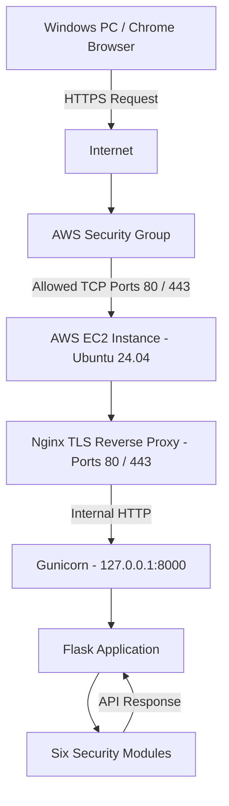

# GameShield AI — AWS Network Architecture

## Network Architecture Diagram

## Network Components

| Component | Purpose |
|---|---|
| Windows Chrome | Accesses the GameShield AI dashboard |
| AWS Security Group | Controls inbound network access |
| SSH Port 22 | Allows remote server administration through PuTTY |
| HTTP Port 80 | Redirects to HTTPS and serves the ACME challenge |
| HTTPS Port 443 | Serves the TLS-protected dashboard and API |
| Let's Encrypt / Certbot | Provides the IP-address certificate and automatic renewal |
| Nginx | Reverse proxy |
| Gunicorn | Runs the Flask application |
| Flask | Handles dashboard and API requests |

## Security Configuration

- SSH access is restricted to an authorized IP address.
- HTTP redirects to HTTPS; the ACME HTTP challenge remains accessible for renewal.
- HTTPS terminates at Nginx using a Let's Encrypt IP-address certificate.
- Gunicorn listens on 127.0.0.1:8000 and is not directly exposed to the internet.
- Nginx forwards requests internally to Gunicorn over localhost HTTP.
- systemd automatically starts the application service.
- Certbot's automatic renewal timer is enabled.

## Important Limitations

- The IP-address certificate is short-lived and requires reliable automatic renewal.
- Full EC2 disaster recovery has not been verified, and the root EBS volume remains unencrypted.
- Public API security and production hardening are not fully verified.
- Do not transmit real passwords, biometric information, or sensitive personal data.
- This architecture represents an educational demonstration, not a fully hardened production deployment.
