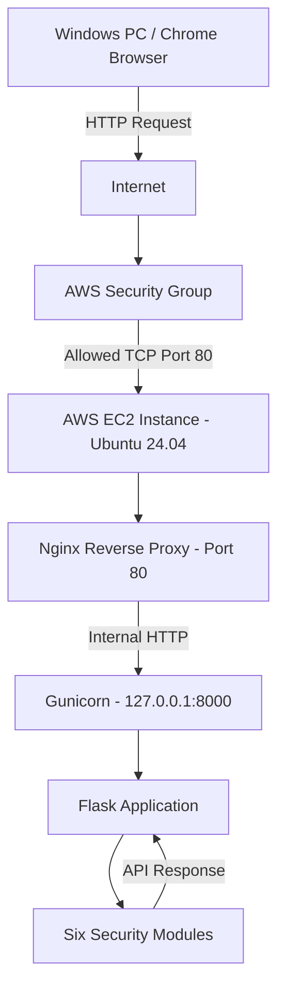

# GameShield AI — AWS Network Architecture

## Network Architecture Diagram



## Network Components

| Component | Purpose |
|---|---|
| Windows Chrome | Accesses the GameShield AI dashboard |
| AWS Security Group | Controls inbound network access |
| SSH Port 22 | Allows remote server administration through PuTTY |
| HTTP Port 80 | Serves the demonstration dashboard |
| Nginx | Reverse proxy |
| Gunicorn | Runs the Flask application |
| Flask | Handles dashboard and API requests |

## Security Configuration

- SSH access is restricted to an authorized IP address.
- HTTP access is restricted to the configured security group source.
- Gunicorn listens on 127.0.0.1:8000 and is not directly exposed to the internet.
- Nginx forwards HTTP requests to Gunicorn.
- systemd automatically starts the application service.

## Important Limitations

- HTTPS/TLS has not yet been configured.
- HTTP traffic is not encrypted.
- Do not transmit real passwords, biometric information, or sensitive personal data.
- This architecture represents an educational demonstration, not a fully hardened production deployment.
```