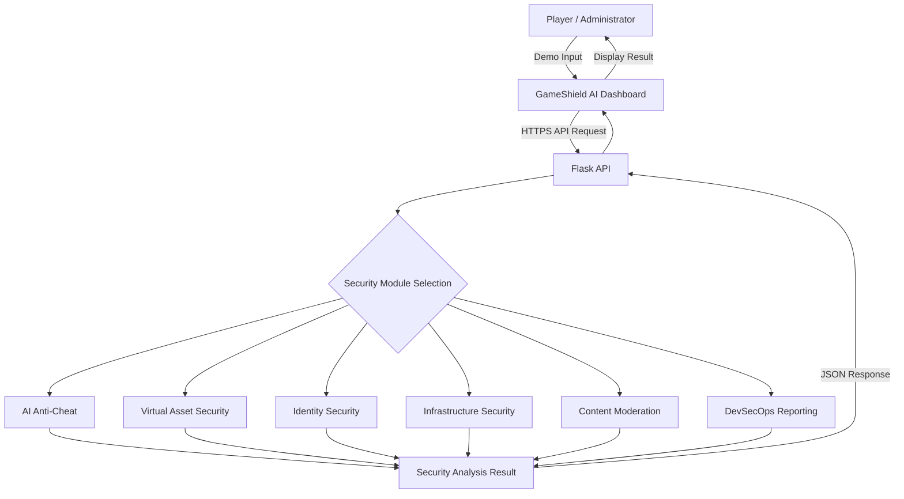

# GameShield AI — Data Flow Diagram

## Level 1: Security Analysis Data Flow

## Example: Anti-Cheat Detection

1. Player behavior data is submitted through the dashboard.
2. Flask receives the API request.
3. The anti-cheat module analyzes the submitted behavior.
4. The trained machine learning model generates a prediction.
5. Flask returns the analysis result.
6. The dashboard displays the result.

## Data Protection

- Security analysis uses demonstration data.
- Biometric information should not be exposed in logs.
- Sensitive identity data must be protected.
- The deployed public transport uses HTTPS, but stronger access controls and
  production-hardening evidence are still required.
