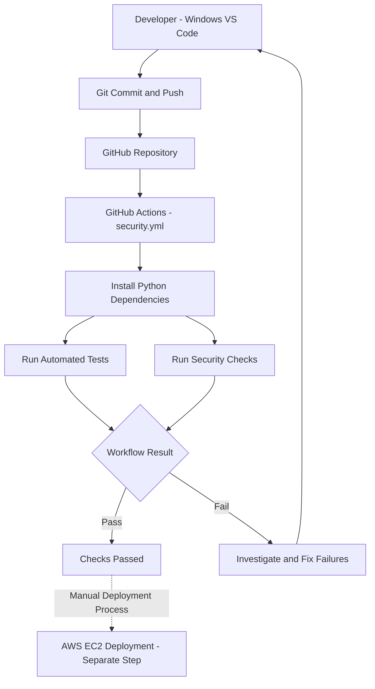

# GameShield AI — DevSecOps CI/CD Workflow

## Overview

GameShield AI uses GitHub Actions to automate security checks during development.

## Workflow Diagram

## Development Workflow

1. Developer modifies the project in VS Code.
2. Git commits are pushed to GitHub.
3. GitHub Actions starts the configured security workflow.
4. Automated tests and security checks execute.
5. Results are displayed in the GitHub Actions interface.
6. Failed checks are investigated and corrected.
7. Deployment to AWS EC2 is handled separately.

## Tools

- Git and GitHub
- GitHub Actions
- Python
- Pytest
- Bandit
- Dependency security auditing
- AWS EC2
- Nginx
- Gunicorn

## Important Clarification

This workflow documents automated CI security checks.

It does not claim that GitHub Actions automatically deploys code to AWS EC2. Deployment is a separate process.