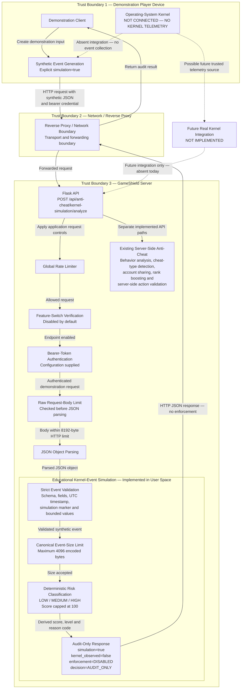

# GameShield AI — Kernel-Event Simulation Architecture

## Architecture Diagram

## Interpretation

Solid arrows represent the implemented request and response flow. The
demonstration client creates explicitly synthetic events, which cross the
network boundary and are processed by Flask, application security controls,
strict validation and deterministic audit-only classification.

Dashed arrows represent absent or future integration only. The operating-system
kernel is not connected to this pipeline, and the application does not collect
kernel telemetry, load a kernel module, attach eBPF programs or provide kernel
protection. The future integration node is architectural context, not an
implemented capability.

The educational simulation is separate from the existing server-side
anti-cheat functions. Those server-side functions analyze submitted game and
player data, while this pipeline classifies synthetic kernel-like events. A
simulation result is evidence of deterministic application behavior only; it
does not prove cheating, prevent cheating or establish that an event originated
from the operating-system kernel.
