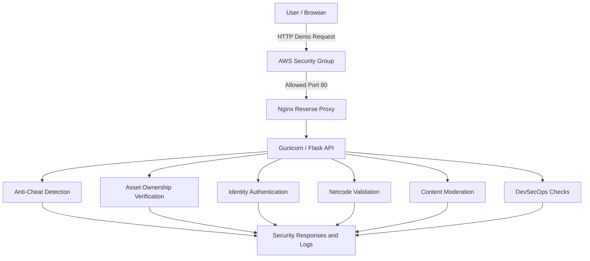

# GameShield AI — Security Architecture

## Security Architecture Diagram



## Security Layers

### Layer 1 — Network Security

- AWS Security Group restricts inbound connections.
- Gunicorn is bound to localhost.
- Nginx handles incoming HTTP requests.

### Layer 2 — Application Security

- Flask processes security API requests.
- Server-side validation demonstrates protection against invalid game actions.
- Netcode checks demonstrate packet verification.

### Layer 3 — Gaming Security

- Anti-cheat detection analyzes sample player behavior.
- Virtual asset controls demonstrate ownership verification.
- Moderation checks analyze submitted text.

### Layer 4 — Identity Security

- Authentication demonstrates identity controls.
- Biometric protection demonstrates secure handling of sensitive information.
- Privacy controls demonstrate user preferences.

### Layer 5 — DevSecOps

- GitHub Actions runs automated security checks.
- Pytest validates application behavior.
- Bandit and dependency auditing support security assessment.

## Security Limitations

- HTTPS/TLS is not yet configured.
- The application is a demonstration, not a production-ready security platform.
- Comprehensive DDoS mitigation is not implemented.
- Live voice capture and kernel-level anti-cheat are not implemented.
- Blockchain-based ownership verification is not implemented.
```