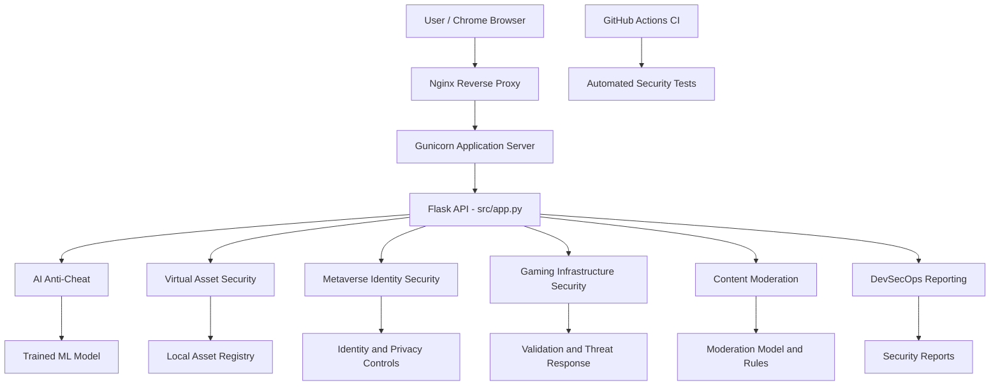

# GameShield AI — System Architecture

## Overview

GameShield AI is an educational gaming and VR/AR security demonstration platform deployed on AWS EC2.

## Architecture Diagram

## Deployment Environment

- Cloud Provider: AWS EC2
- Operating System: Ubuntu 24.04 LTS
- Reverse Proxy: Nginx
- Application Server: Gunicorn
- Backend Framework: Flask
- Machine Learning: Scikit-learn
- CI/CD Security: GitHub Actions

## Scope and Limitations

This is an educational demonstration platform.

- Anti-cheat detection uses sample player behavior.
- Asset ownership uses a local registry, not a live blockchain.
- Biometric protection demonstrates secure data handling rather than live VR sensors.
- Infrastructure protection demonstrates application-level security controls, not comprehensive DDoS mitigation.
- Moderation processes text or supplied transcripts, not live microphone audio.
- DevSecOps demonstrates automated security checks.